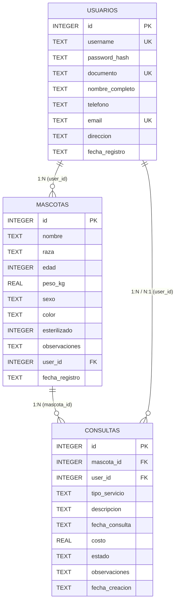

# Guía de API y Contrato de Endpoints para Frontend

**Proyecto:** Sistema para el registro de salud, estética y recreación de caninos  
**Backend:** ASP.NET Core Web API (.NET) + SQLite  
**Versión:** 2.0.0  

Este documento define **todos los endpoints**, **roles y middleware global de permisos (`usuario` / `admin`)**, **qué datos y tipos exactos esperan**, **qué códigos HTTP y respuestas devuelven**, **qué casos de extremo valida el backend** y **cómo consumirlos desde el frontend**.

---

## 1. Información General

| Parámetro | Valor |
| :--- | :--- |
| **URL Base (local)** | `http://localhost:5150` (`/` redirige a `/login`) |
| **Swagger UI (pruebas visuales)** | `http://localhost:5150/swagger` |
| **Prefijo de la API** | `/api` |
| **Formato de intercambio** | `application/json` (UTF-8) y `multipart/form-data` para subir fotos |
| **Formato de fechas** | ISO-8601 UTC (ejemplo: `2026-11-25T15:30:00Z`) |
| **Autenticación y Roles** | Bearer JWT (`Authorization: Bearer <token>`) con roles `usuario` y `admin` gestionados globalmente por `PermissionsMiddleware` |
| **CORS** | Habilitado para orígenes locales (`localhost` / `127.0.0.1` en cualquier puerto) |

### Credenciales iniciales (usuario semilla)

Al iniciar el backend por primera vez con la base de datos vacía, se crea automáticamente un usuario administrador inicial:

- **`username`:** `admin`
- **`password`:** `12345`
- **`rol`:** `admin`

> Al registrarse mediante `POST /api/auth/register`, la cuenta siempre se crea con rol `usuario`.

### Matriz global de permisos (`PermissionsMiddleware`)

| Rol | Alcance | Respuesta si intenta exceder permisos |
| :--- | :--- | :---: |
| **`admin`** | Control total sobre `/api/usuarios`, `/api/mascotas`, `/api/consultas`, `/api/perfil` y `/api/uploads`. | — |
| **`usuario`** | Acceso a su propio perfil (`/api/perfil`, `/api/perfil/password`), subida de fotos (`/api/uploads/mascotas`), sus propias mascotas (`/api/mascotas`, `/api/mascotas/{id}/historial`) y sus propias consultas. | **`403 Forbidden`** |

### Nuevos endpoints (v2.0.0)

| Método | Ruta | Auth / Permiso | Descripción |
| :---: | :--- | :--- | :--- |
| `GET` | `/api/perfil` | Autenticado (`usuario` / `admin`) | Obtiene los datos del usuario autenticado (incluyendo `rol`). |
| `PUT` | `/api/perfil` | Autenticado (`usuario` / `admin`) | Actualiza los datos personales propios sin modificar el rol. |
| `PUT` | `/api/perfil/password` | Autenticado (`usuario` / `admin`) | Cambia la contraseña numérica (`passwordActual`, `passwordNueva`, `confirmarPassword`). |
| `POST` | `/api/uploads/mascotas` | Autenticado (`usuario` / `admin`) | Sube foto de mascota (`multipart/form-data`, campo `file`, JPG/PNG/WEBP máx. 5 MB) y devuelve `{ "fotoUrl": "/uploads/mascotas/..." }`. |
| `GET` | `/api/mascotas/{id}/historial` | Dueño o `admin` | Devuelve `proximaCita`, `citasPrevias` y `todasLasConsultas` (con `operacionId` y `operacionNombre`) usando el índice compuesto `ix_consultas_mascota_id_fecha`. |
| `GET` | `/api/operaciones` | Autenticado (`usuario` / `admin`) | Lista el catálogo dinámico de operaciones/procedimientos y sus precios (`?tipoServicio=&soloActivas=true`). |
| `GET` | `/api/operaciones/{id}` | Autenticado (`usuario` / `admin`) | Obtiene el detalle y costo actual de una operación. |
| `POST` | `/api/operaciones` | Solo `admin` | Crea un nuevo procedimiento en el catálogo con `nombre`, `tipoServicio`, `descripcion`, `costo` y `activo`. |
| `PUT` | `/api/operaciones/{id}` | Solo `admin` | Actualiza dinámicamente el nombre, categoría, disponibilidad o `costo` en la base de datos. |
| `DELETE` | `/api/operaciones/{id}` | Solo `admin` | Elimina la operación si no está asociada al historial de consultas (`409 Conflict` si ya tiene historial). |

> **Campos adicionales y cálculo automático:**
> - `UsuarioResponse` incluye `rol` (`"usuario"` | `"admin"`).
> - `MascotaResponse` incluye `fotoUrl`, `proximaCita` y `totalHistorial`.
> - `ConsultaResponse` y `ConsultaResumenDto` incluyen `operacionId` y `operacionNombre`.
> - Al enviar `operacionId` en `POST /api/consultas` (ej. `{ "mascotaId": 1, "operacionId": 2, "fechaConsulta": "..." }`), el backend calcula y asigna **automáticamente** `costo`, `tipoServicio`, `descripcion` desde la tabla `operaciones`, y asigna `estado = "Programada"` automáticamente para el rol `usuario`.
> - `POST /api/consultas` (y `PUT /api/consultas/{id}` con estado `Programada`) valida que `fechaConsulta` **no sea anterior a la fecha y hora actual** (`400 Bad Request`).

---

## 2. Modelo de Base de Datos (SQLite)

La base de datos utiliza **SQLite** con integridad referencial activa (`PRAGMA foreign_keys = ON`) y **3 tablas sin roles**:



### Reglas de relaciones
1. **`usuarios` → `mascotas` (1:N):** Cada mascota pertenece obligatoriamente a un usuario (`mascotas.user_id`).
2. **`mascotas` → `consultas` (1:N):** Cada consulta está asociada obligatoriamente a una mascota (`consultas.mascota_id`).
3. **`consultas` → `usuarios` (N:1):** Cada consulta tiene además la llave foránea `consultas.user_id`, y el backend valida que **la mascota pertenezca realmente al usuario indicado** (`mascota.userId === consulta.userId`).
4. **Integridad al eliminar (`ON DELETE RESTRICT`):**
   - No se puede eliminar un `usuario` si tiene `mascotas` o `consultas` asociadas (`409 Conflict`).
   - No se puede eliminar una `mascota` si tiene `consultas` asociadas (`409 Conflict`).
   - No se puede reasignar el propietario (`userId`) de una `mascota` que ya tiene `consultas` registradas (`409 Conflict`).

---

## 3. Convenciones de Peticiones, Códigos HTTP y Errores

### Headers requeridos

- En toda petición `POST` y `PUT`:
  ```http
  Content-Type: application/json
  ```
- En todos los endpoints protegidos (`/api/usuarios`, `/api/mascotas`, `/api/consultas`):
  ```http
  Authorization: Bearer <token_jwt>
  ```

### Tabla de códigos HTTP

| Código | Significado | Cuándo ocurre |
| :---: | :--- | :--- |
| **`200 OK`** | Éxito con contenido | Consultas (`GET`), actualizaciones (`PUT`), login (`POST /api/auth/login`) y health check. |
| **`201 Created`** | Recurso creado | Creación en `POST /api/auth/register`, `POST /api/usuarios`, `POST /api/mascotas`, `POST /api/consultas`. Incluye header `Location`. |
| **`204 No Content`** | Eliminado sin cuerpo | Eliminación exitosa en `DELETE` (la respuesta **no trae JSON**, no ejecutar `res.json()`). |
| **`400 Bad Request`** | Error de validación o tipo | Campos faltantes, tipos JSON incorrectos (ej. número donde se espera string), password no numérico o `< 5` dígitos, ID `<= 0` o no numérico, JSON malformado, valores fuera de rango o de catálogo. |
| **`401 Unauthorized`** | No autenticado | Credenciales inválidas en login, header `Authorization` ausente, token malformado o token expirado. |
| **`404 Not Found`** | Recurso no encontrado | El `id` buscado no existe, o una FK (`userId` / `mascotaId`) no corresponde a ningún registro en la BD. |
| **`405 Method Not Allowed`** | Método no permitido | Uso de un verbo HTTP no soportado en la ruta (ej. `PATCH`). |
| **`409 Conflict`** | Conflicto de negocio / integridad | `username`, `documento` o `email` duplicado; `mascotaId` no pertenece a `userId`; intento de eliminar usuario/mascota con registros dependientes; cambio de dueño en mascota con consultas. |
| **`415 Unsupported Media Type`** | Content-Type inválido | Enviar `POST` o `PUT` sin `Content-Type: application/json`. |
| **`500 Internal Server Error`** | Error interno inesperado | Falla no controlada del servidor. |

### Formato estándar de respuesta de error

**Todos los errores (`400`, `401`, `404`, `405`, `409`, `415`, `500`)** devuelven exactamente esta estructura JSON:

```json
{
  "status": 400,
  "error": "Bad Request",
  "message": "Error de validación en los datos enviados.",
  "errors": {
    "password": [
      "La contraseña debe ser estrictamente numérica y tener mínimo 5 dígitos."
    ]
  },
  "timestamp": "2026-11-22T16:30:00Z"
}
```

> `errors` siempre es un objeto JSON (`{}` cuando el error no corresponde a un campo puntual, por ejemplo en `401` o `404`).

---

## 4. Resumen Rápido de Endpoints

| Módulo | Método | Ruta | Auth | Éxito | Errores posibles |
| :--- | :---: | :--- | :---: | :---: | :--- |
| **Sistema** | `GET` | `/api/health` | No | `200` | `500` |
| **Auth** | `POST` | `/api/auth/login` | No | `200` | `400`, `401`, `415` |
| **Auth** | `POST` | `/api/auth/register` | No | `201` | `400`, `409`, `415` |
| **Usuarios** | `GET` | `/api/usuarios` | Sí | `200` | `401` |
| **Usuarios** | `GET` | `/api/usuarios/{id}` | Sí | `200` | `400`, `401`, `404` |
| **Usuarios** | `GET` | `/api/usuarios/{id}/mascotas` | Sí | `200` | `400`, `401`, `404` |
| **Usuarios** | `POST` | `/api/usuarios` | Sí | `201` | `400`, `401`, `409`, `415` |
| **Usuarios** | `PUT` | `/api/usuarios/{id}` | Sí | `200` | `400`, `401`, `404`, `409`, `415` |
| **Usuarios** | `DELETE` | `/api/usuarios/{id}` | Sí | `204` | `400`, `401`, `404`, `409` |
| **Mascotas** | `GET` | `/api/mascotas` | Sí | `200` | `400`, `401` |
| **Mascotas** | `GET` | `/api/mascotas/{id}` | Sí | `200` | `400`, `401`, `404` |
| **Mascotas** | `POST` | `/api/mascotas` | Sí | `201` | `400`, `401`, `404`, `415` |
| **Mascotas** | `PUT` | `/api/mascotas/{id}` | Sí | `200` | `400`, `401`, `404`, `409`, `415` |
| **Mascotas** | `DELETE` | `/api/mascotas/{id}` | Sí | `204` | `400`, `401`, `404`, `409` |
| **Consultas** | `GET` | `/api/consultas` | Sí | `200` | `400`, `401` |
| **Consultas** | `GET` | `/api/consultas/{id}` | Sí | `200` | `400`, `401`, `404` |
| **Consultas** | `GET` | `/api/consultas/usuario/{userId}` | Sí | `200` | `400`, `401`, `404` |
| **Consultas** | `GET` | `/api/consultas/mascota/{mascotaId}` | Sí | `200` | `400`, `401`, `404` |
| **Consultas** | `GET` | `/api/consultas/servicio/{tipoServicio}` | Sí | `200` | `400`, `401` |
| **Consultas** | `POST` | `/api/consultas` | Sí | `201` | `400`, `401`, `404`, `409`, `415` |
| **Consultas** | `PUT` | `/api/consultas/{id}` | Sí | `200` | `400`, `401`, `404`, `409`, `415` |
| **Consultas** | `DELETE` | `/api/consultas/{id}` | Sí | `204` | `400`, `401`, `404` |

---

## 5. Especificación Detallada de Endpoints

### 5.1. Sistema

#### `GET /api/health`
Verifica que el backend y SQLite estén activos. **No requiere token.**

- **Respuesta `200 OK`:**
  ```json
  {
    "status": "ok",
    "database": "sqlite",
    "timestamp": "2026-11-22T16:30:00Z"
  }
  ```

---

### 5.2. Módulo de Autenticación (`/api/auth`)

#### `POST /api/auth/login`
Inicia sesión validando `username` y `password` numérico de mínimo 5 dígitos. **No requiere token.**

- **Body esperado:**

| Campo | Tipo JSON | Obligatorio | Reglas de validación |
| :--- | :--- | :---: | :--- |
| `username` | `string` | Sí | Longitud 3–50, sin espacios, regex `^[a-zA-Z0-9._-]+$` |
| `password` | `string` | Sí | **Solo dígitos `0-9`**, longitud 5–20 (`^\d{5,20}$`). **Debe enviarse como string** (ej. `"12345"` o `"00123"`), no como número JSON. |

- **Ejemplo de petición:**
  ```json
  {
    "username": "admin",
    "password": "12345"
  }
  ```
- **Respuesta `200 OK`:**
  ```json
  {
    "token": "eyJhbGciOiJIUzI1NiIsInR5cCI6IkpXVCJ9...",
    "tokenType": "Bearer",
    "expiresAt": "2026-11-23T00:30:00Z",
    "usuario": {
      "id": 1,
      "username": "admin",
      "documento": "1000000000",
      "nombreCompleto": "Administrador del Centro",
      "telefono": "3000000000",
      "email": "admin@centrocanino.local",
      "direccion": "Sede Principal",
      "fechaRegistro": "2026-11-22T16:00:00Z"
    }
  }
  ```
- **Errores:**
  - `400 Bad Request`: `password` con letras/espacios/símbolos, menor a 5 dígitos, enviado como entero (`12345`), o campos vacíos.
  - `401 Unauthorized`: usuario inexistente o contraseña incorrecta (`"Usuario o contraseña incorrectos."`).
  - `415 Unsupported Media Type`: falta `Content-Type: application/json`.

---

#### `POST /api/auth/register`
Registra un nuevo usuario/cliente sin requerir sesión previa y retorna su token JWT. **No requiere token.**

- **Body esperado:** Igual que [`POST /api/usuarios`](#post-apiusuarios).
- **Respuesta `201 Created`:** Misma estructura que `POST /api/auth/login` (incluye `token`, `tokenType`, `expiresAt`, `usuario`).
- **Errores:** `400 Bad Request`, `409 Conflict` (`username`, `documento` o `email` ya existen), `415 Unsupported Media Type`.

---

### 5.3. Módulo de Usuarios / Clientes (`/api/usuarios`)

Todos los endpoints de este módulo requieren `Authorization: Bearer <token>`.  
**Seguridad:** Ninguna respuesta devuelve `password` ni `passwordHash`.

#### Esquema de respuesta `UsuarioResponse`
```json
{
  "id": 2,
  "username": "carlos.gomez",
  "documento": "1020304050",
  "nombreCompleto": "Carlos Gómez Pérez",
  "telefono": "3105551234",
  "email": "carlos.gomez@email.com",
  "direccion": "Calle 45 # 12-30, Bogotá",
  "fechaRegistro": "2026-11-22T16:35:00Z"
}
```

#### `GET /api/usuarios`
Lista todos los usuarios/clientes registrados.

- **Query params opcionales:**
  - `search` (`string`, máx 100 caracteres): filtra parcialmente por `username`, `documento`, `nombreCompleto` o `email`.
- **Respuesta `200 OK`:** `UsuarioResponse[]` (arreglo vacío `[]` si no hay coincidencias).
- **Errores:** `401 Unauthorized`.

#### `GET /api/usuarios/{id}`
Obtiene un usuario por su ID.

- **Path param:** `id` (`integer > 0`).
- **Respuesta `200 OK`:** `UsuarioResponse`.
- **Errores:**
  - `400 Bad Request`: `id` no es entero o es `<= 0` (ej. `/api/usuarios/abc` o `/api/usuarios/0`).
  - `401 Unauthorized`.
  - `404 Not Found`: no existe un usuario con ese `id`.

#### `GET /api/usuarios/{id}/mascotas`
Obtiene todas las mascotas pertenecientes al usuario indicado.

- **Path param:** `id` (`integer > 0`).
- **Respuesta `200 OK`:** `MascotaResponse[]` (arreglo vacío `[]` si el usuario existe y aún no tiene mascotas).
- **Errores:** `400 Bad Request`, `401 Unauthorized`, `404 Not Found` (el usuario no existe).

#### `POST /api/usuarios`
Crea un nuevo usuario/cliente.

- **Body esperado:**

| Campo | Tipo JSON | Obligatorio | Reglas de validación |
| :--- | :--- | :---: | :--- |
| `username` | `string` | Sí | 3–50 chars, regex `^[a-zA-Z0-9._-]+$`, único (insensible a mayúsculas, se normaliza a minúsculas). |
| `password` | `string` | Sí | **Solo dígitos `0-9`**, 5–20 caracteres (`^\d{5,20}$`). |
| `documento` | `string` | Sí | 5–20 chars, regex `^[0-9A-Za-z-]+$`, único. |
| `nombreCompleto` | `string` | Sí | 2–120 chars, no puede ser solo espacios ni solo números. |
| `telefono` | `string` | Sí | 7–20 chars, formato `^\+?[0-9\s-]+$` con 7–15 dígitos reales. |
| `email` | `string` | Sí | Correo electrónico válido, máx 150 chars, único (normalizado a minúsculas). |
| `direccion` | `string` | Sí | 5–200 chars, no puede ser solo espacios. |

- **Ejemplo de petición:**
  ```json
  {
    "username": "carlos.gomez",
    "password": "54321",
    "documento": "1020304050",
    "nombreCompleto": "Carlos Gómez Pérez",
    "telefono": "3105551234",
    "email": "carlos.gomez@email.com",
    "direccion": "Calle 45 # 12-30, Bogotá"
  }
  ```
- **Respuesta `201 Created`:** `UsuarioResponse` + header `Location: /api/usuarios/{id}`.
- **Errores:**
  - `400 Bad Request`: validaciones de tipo/formato/rango.
  - `401 Unauthorized`.
  - `409 Conflict`: `username`, `documento` o `email` ya registrados.
  - `415 Unsupported Media Type`.

#### `PUT /api/usuarios/{id}`
Actualiza los datos de un usuario existente.

- **Path param:** `id` (`integer > 0`).
- **Body esperado:** Mismos campos y reglas que `POST /api/usuarios`, **con una diferencia**:
  - `password` es **opcional**: si se omite o se envía `null`, se conserva la contraseña actual. Si se envía una cadena (incluso `""`), debe cumplir `^\d{5,20}$`.
- **Respuesta `200 OK`:** `UsuarioResponse` actualizado.
- **Errores:** `400 Bad Request`, `401 Unauthorized`, `404 Not Found`, `409 Conflict` (conflicto de unicidad con otro usuario), `415 Unsupported Media Type`.

#### `DELETE /api/usuarios/{id}`
Elimina un usuario si no tiene mascotas ni consultas asociadas.

- **Path param:** `id` (`integer > 0`).
- **Respuesta `204 No Content`:** Sin cuerpo.
- **Errores:**
  - `400 Bad Request`: `id` inválido.
  - `401 Unauthorized`.
  - `404 Not Found`: usuario no existe.
  - `409 Conflict`: el usuario tiene mascotas o consultas registradas.

---

### 5.4. Módulo de Mascotas / Caninos (`/api/mascotas`)

Todos los endpoints requieren `Authorization: Bearer <token>`.

#### Esquema de respuesta `MascotaResponse`
```json
{
  "id": 1,
  "nombre": "Max",
  "raza": "Golden Retriever",
  "edad": 3,
  "pesoKg": 28.5,
  "sexo": "Macho",
  "color": "Dorado",
  "esterilizado": true,
  "observaciones": "Vacunas al día",
  "userId": 2,
  "propietarioNombre": "Carlos Gómez Pérez",
  "fechaRegistro": "2026-11-22T16:40:00Z"
}
```

#### `GET /api/mascotas`
Lista todas las mascotas registradas.

- **Query params opcionales:**
  - `userId` (`integer > 0`): filtra mascotas por ID de propietario.
- **Respuesta `200 OK`:** `MascotaResponse[]`.
- **Errores:** `400 Bad Request` (`userId` no numérico o `<= 0`), `401 Unauthorized`.

#### `GET /api/mascotas/{id}`
Obtiene una mascota por su ID.

- **Path param:** `id` (`integer > 0`).
- **Respuesta `200 OK`:** `MascotaResponse`.
- **Errores:** `400 Bad Request`, `401 Unauthorized`, `404 Not Found`.

#### `POST /api/mascotas`
Registra un nuevo canino asociado a un usuario propietario (`userId`).

- **Body esperado:**

| Campo | Tipo JSON | Obligatorio | Reglas de validación |
| :--- | :--- | :---: | :--- |
| `nombre` | `string` | Sí | 1–80 chars, no puede ser solo espacios. |
| `raza` | `string` | Sí | 2–80 chars, no puede ser solo espacios. |
| `edad` | `integer` | Sí | Entero entre `0` y `30` (años). No acepta decimales ni strings. |
| `pesoKg` | `number` | Sí | Número entre `0.2` y `120.0`, máximo 2 decimales. |
| `sexo` | `string` | Sí | Valores permitidos: `"Macho"` o `"Hembra"` (insensible a mayúsculas, se normaliza). |
| `color` | `string` | Sí | 2–50 chars, no puede ser solo espacios. |
| `esterilizado` | `boolean` | Sí | Booleano estricto (`true` o `false`, no string). |
| `observaciones` | `string \| null` | No | Máximo 500 chars. |
| `userId` | `integer` | Sí | Entero `> 0`, debe existir en la tabla `usuarios`. |

- **Ejemplo de petición:**
  ```json
  {
    "nombre": "Max",
    "raza": "Golden Retriever",
    "edad": 3,
    "pesoKg": 28.5,
    "sexo": "Macho",
    "color": "Dorado",
    "esterilizado": true,
    "observaciones": "Vacunas al día",
    "userId": 2
  }
  ```
- **Respuesta `201 Created`:** `MascotaResponse` + header `Location: /api/mascotas/{id}`.
- **Errores:**
  - `400 Bad Request`: errores de tipo, rango o campos obligatorios faltantes.
  - `401 Unauthorized`.
  - `404 Not Found`: el `userId` indicado no existe.
  - `415 Unsupported Media Type`.

#### `PUT /api/mascotas/{id}`
Actualiza los datos de una mascota existente.

- **Path param:** `id` (`integer > 0`).
- **Body esperado:** Mismos campos y reglas que `POST /api/mascotas`.
- **Respuesta `200 OK`:** `MascotaResponse` actualizado.
- **Errores:**
  - `400 Bad Request`: `id` inválido o campos inválidos.
  - `401 Unauthorized`.
  - `404 Not Found`: la mascota o el `userId` especificado no existen.
  - `409 Conflict`: se intentó cambiar el `userId` de una mascota que ya tiene consultas registradas.
  - `415 Unsupported Media Type`.

#### `DELETE /api/mascotas/{id}`
Elimina una mascota si no tiene consultas asociadas.

- **Path param:** `id` (`integer > 0`).
- **Respuesta `204 No Content`:** Sin cuerpo.
- **Errores:** `400 Bad Request`, `401 Unauthorized`, `404 Not Found`, `409 Conflict` (la mascota tiene consultas registradas).

---

### 5.5. Módulo de Consultas (`/api/consultas`)

Todos los endpoints requieren `Authorization: Bearer <token>`.

#### Valores permitidos de catálogos
- **`tipoServicio`**: `"Salud"`, `"Estetica"`, `"Recreacion"`  
  *(También se aceptan `"Estética"` y `"Recreación"` con tilde y en cualquier combinación de mayúsculas/minúsculas; el backend los normaliza a `"Salud"`, `"Estetica"` o `"Recreacion"`.)*
- **`estado`**: `"Programada"`, `"EnProceso"`, `"Completada"`, `"Cancelada"`  
  *(Insensible a mayúsculas/minúsculas; se normaliza al formato exacto indicado.)*

#### Esquema de respuesta `ConsultaResponse`
```json
{
  "id": 1,
  "mascotaId": 1,
  "userId": 2,
  "tipoServicio": "Salud",
  "descripcion": "Vacunación anual antirrábica y control general",
  "fechaConsulta": "2026-11-25T10:00:00Z",
  "costo": 85000.00,
  "estado": "Programada",
  "observaciones": "Traer carné de vacunación",
  "mascotaNombre": "Max",
  "mascotaRaza": "Golden Retriever",
  "usuarioNombre": "Carlos Gómez Pérez",
  "fechaCreacion": "2026-11-22T16:45:00Z"
}
```

#### `GET /api/consultas`
Lista consultas y permite filtrar de forma individual o combinada por **ID del cliente**, **ID del canino**, **tipo de servicio** y **estado**.

- **Query params opcionales (combinables):**

| Parámetro | Tipo | Validación | Ejemplo |
| :--- | :--- | :--- | :--- |
| `userId` | `integer` | `> 0` | `?userId=2` |
| `mascotaId` | `integer` | `> 0` | `?mascotaId=1` |
| `tipoServicio` | `string` | `Salud`, `Estetica` / `Estética`, `Recreacion` / `Recreación` | `?tipoServicio=Salud` |
| `estado` | `string` | `Programada`, `EnProceso`, `Completada`, `Cancelada` | `?estado=Programada` |

- **Ejemplos de uso:**
  - `GET /api/consultas` → todas las consultas
  - `GET /api/consultas?userId=2` → consultas del cliente 2
  - `GET /api/consultas?mascotaId=1` → consultas de la mascota 1
  - `GET /api/consultas?tipoServicio=Estetica` → consultas de estética
  - `GET /api/consultas?userId=2&tipoServicio=Salud` → filtro combinado
- **Respuesta `200 OK`:** `ConsultaResponse[]`.
- **Errores:** `400 Bad Request` (parámetro con tipo o valor de catálogo inválido), `401 Unauthorized`.

#### `GET /api/consultas/{id}`
Obtiene una consulta puntual por su ID.

- **Path param:** `id` (`integer > 0`).
- **Respuesta `200 OK`:** `ConsultaResponse`.
- **Errores:** `400 Bad Request`, `401 Unauthorized`, `404 Not Found`.

#### `GET /api/consultas/usuario/{userId}`
Consulta directa de todos los servicios asociados al **ID del cliente** (`userId`).

- **Path param:** `userId` (`integer > 0`).
- **Respuesta `200 OK`:** `ConsultaResponse[]` (`[]` si el cliente existe y no tiene consultas).
- **Errores:** `400 Bad Request`, `401 Unauthorized`, `404 Not Found` (el usuario no existe).

#### `GET /api/consultas/mascota/{mascotaId}`
Consulta directa de todos los servicios asociados al **ID del canino** (`mascotaId`).

- **Path param:** `mascotaId` (`integer > 0`).
- **Respuesta `200 OK`:** `ConsultaResponse[]` (`[]` si la mascota existe y no tiene consultas).
- **Errores:** `400 Bad Request`, `401 Unauthorized`, `404 Not Found` (la mascota no existe).

#### `GET /api/consultas/servicio/{tipoServicio}`
Consulta directa de todos los registros filtrados por **tipo de servicio**.

- **Path param:** `tipoServicio` (`Salud`, `Estetica` / `Estética`, `Recreacion` / `Recreación`).
- **Respuesta `200 OK`:** `ConsultaResponse[]`.
- **Errores:** `400 Bad Request` (tipo de servicio no reconocido), `401 Unauthorized`.

#### `POST /api/consultas`
Registra una nueva consulta de salud, estética o recreación.

- **Body esperado:**

| Campo | Tipo JSON | Obligatorio | Reglas de validación |
| :--- | :--- | :---: | :--- |
| `userId` | `integer` | Sí | Entero `> 0`, debe existir en `usuarios`. |
| `mascotaId` | `integer` | Sí | Entero `> 0`, debe existir en `mascotas` y **pertenecer al `userId` enviado**. |
| `tipoServicio` | `string` | Sí | `"Salud"`, `"Estetica"` (o `"Estética"`), `"Recreacion"` (o `"Recreación"`). |
| `descripcion` | `string` | Sí | 5–500 chars, no puede ser solo espacios. |
| `fechaConsulta` | `string` | Sí | Fecha/hora ISO-8601 válida entre `2000-01-01` y `2100-12-31`. |
| `costo` | `number` | Sí | Número entre `0` y `100000000`, máximo 2 decimales (no negativo). |
| `estado` | `string \| null` | No | Opcional (por defecto `"Programada"`). Valores: `"Programada"`, `"EnProceso"`, `"Completada"`, `"Cancelada"`. |
| `observaciones` | `string \| null` | No | Máximo 500 chars. |

- **Ejemplo de petición:**
  ```json
  {
    "userId": 2,
    "mascotaId": 1,
    "tipoServicio": "Salud",
    "descripcion": "Vacunación anual antirrábica y control general",
    "fechaConsulta": "2026-11-25T10:00:00Z",
    "costo": 85000,
    "estado": "Programada",
    "observaciones": "Traer carné de vacunación"
  }
  ```
- **Respuesta `201 Created`:** `ConsultaResponse` + header `Location: /api/consultas/{id}`.
- **Errores:**
  - `400 Bad Request`: tipos incorrectos, campos faltantes, `costo < 0`, `tipoServicio` inválido, fecha inválida.
  - `401 Unauthorized`.
  - `404 Not Found`: el `userId` o el `mascotaId` no existen.
  - `409 Conflict`: la mascota `mascotaId` no pertenece al usuario `userId`.
  - `415 Unsupported Media Type`.

#### `PUT /api/consultas/{id}`
Actualiza una consulta existente.

- **Path param:** `id` (`integer > 0`).
- **Body esperado:** Mismos campos que `POST /api/consultas`, con `estado` **obligatorio**.
- **Respuesta `200 OK`:** `ConsultaResponse` actualizado.
- **Errores:** `400 Bad Request`, `401 Unauthorized`, `404 Not Found` (consulta, `userId` o `mascotaId` inexistentes), `409 Conflict` (`mascotaId` no pertenece a `userId`), `415 Unsupported Media Type`.

#### `DELETE /api/consultas/{id}`
Elimina una consulta por su ID.

- **Path param:** `id` (`integer > 0`).
- **Respuesta `204 No Content`:** Sin cuerpo.
- **Errores:** `400 Bad Request`, `401 Unauthorized`, `404 Not Found`.

---

## 6. Casos de Extremo y Validaciones Garantizadas por el Backend

El frontend puede apoyarse en las siguientes garantías del backend (aunque se recomienda replicar validaciones básicas en los formularios para mejor UX):

1. **Contraseña estrictamente numérica (requisito clave del curso):**
   - `"1234"` (4 dígitos) → `400 Bad Request`
   - `"1234a"`, `"12345 "`, `"-12345"`, `"123.45"` → `400 Bad Request`
   - `12345` enviado como número JSON en vez de string `"12345"` → `400 Bad Request`
   - `"00123"` (ceros a la izquierda, 5 dígitos) → **Válido** (`201` / `200`)
2. **Tipado estricto en JSON:**
   - No se convierten strings a números ni strings a booleanos (`"edad": "3"` o `"esterilizado": "true"` devuelven `400 Bad Request`).
   - Omitir un campo numérico/booleano obligatorio (`edad`, `pesoKg`, `esterilizado`, `costo`, `userId`, `mascotaId`, `fechaConsulta`) **no** rellena con `0` o `false`: devuelve `400 Bad Request`.
   - JSON sintácticamente roto o body vacío / `null` devuelve `400 Bad Request` con formato estándar.
3. **IDs de ruta y query inválidos:**
   - IDs no numéricos (`/api/usuarios/abc`), negativos (`-1`), cero (`0`) o mayores a `Int32.MaxValue` devuelven `400 Bad Request`.
4. **Cadenas vacías o solo espacios:**
   - Valores como `"   "` en `nombreCompleto`, `direccion`, `nombre`, `raza`, `descripcion`, etc., son rechazados con `400 Bad Request` y los valores válidos se limpian con `Trim()`.
5. **Duplicados insensibles a mayúsculas:**
   - `username` y `email` comparan en minúsculas (`Admin` y `admin` producen `409 Conflict`).
6. **Consistencia relacional 1:N / N:1:**
   - Crear o actualizar una consulta con una mascota perteneciente a otro cliente devuelve `409 Conflict`.
   - Intentar borrar un cliente con mascotas/consultas o una mascota con consultas devuelve `409 Conflict` (nunca `500`).
   - Intentar cambiar el dueño de una mascota que ya tiene consultas devuelve `409 Conflict`.
7. **Precisión decimal y rangos:**
   - `pesoKg` acepta `0.2` a `120.0` (máx. 2 decimales).
   - `costo` acepta `0` a `100000000` (máx. 2 decimales, nunca negativo).
   - `edad` acepta enteros `0` a `30`.

---

## 7. Guía Rápida de Integración para el Frontend (JavaScript / Fetch)

Puedes copiar este cliente reutilizable (`apiClient.js`) en React, Vue, Angular o JavaScript puro:

```javascript
const API_BASE_URL = "http://localhost:5150/api";

export function getToken() {
  return localStorage.getItem("caninos_token");
}

export function setSession(authData) {
  localStorage.setItem("caninos_token", authData.token);
  localStorage.setItem("caninos_user", JSON.stringify(authData.usuario));
}

export function clearSession() {
  localStorage.removeItem("caninos_token");
  localStorage.removeItem("caninos_user");
}

export async function apiRequest(path, { method = "GET", body, auth = true } = {}) {
  const headers = {};

  if (body !== undefined) {
    headers["Content-Type"] = "application/json";
  }

  if (auth) {
    const token = getToken();
    if (token) {
      headers["Authorization"] = `Bearer ${token}`;
    }
  }

  const response = await fetch(`${API_BASE_URL}${path}`, {
    method,
    headers,
    body: body !== undefined ? JSON.stringify(body) : undefined,
  });

  // 204 No Content (ej. DELETE exitoso) no trae cuerpo JSON
  if (response.status === 204) {
    return null;
  }

  const data = await response.json().catch(() => null);

  if (!response.ok) {
    if (response.status === 401 && auth) {
      clearSession(); // Redirigir al login si el token expiró
    }
    const error = new Error(data?.message || `Error HTTP ${response.status}`);
    error.status = response.status;
    error.errors = data?.errors || {};
    throw error;
  }

  return data;
}
```

### Ejemplos de uso por módulo

```javascript
import { apiRequest, setSession } from "./apiClient";

// 1. Iniciar sesión
const session = await apiRequest("/auth/login", {
  method: "POST",
  auth: false,
  body: { username: "admin", password: "12345" },
});
setSession(session);

// 2. Registrar cliente (usuario)
const nuevoCliente = await apiRequest("/usuarios", {
  method: "POST",
  body: {
    username: "maria.lopez",
    password: "98765",
    documento: "1012345678",
    nombreCompleto: "María López",
    telefono: "3201234567",
    email: "maria@correo.com",
    direccion: "Carrera 15 # 80-20",
  },
});

// 3. Registrar canino (mascota)
const nuevaMascota = await apiRequest("/mascotas", {
  method: "POST",
  body: {
    nombre: "Luna",
    raza: "Beagle",
    edad: 2,
    pesoKg: 11.4,
    sexo: "Hembra",
    color: "Tricolor",
    esterilizado: true,
    observaciones: "Alérgica al pollo",
    userId: nuevoCliente.id,
  },
});

// 4. Registrar consulta
const nuevaConsulta = await apiRequest("/consultas", {
  method: "POST",
  body: {
    userId: nuevoCliente.id,
    mascotaId: nuevaMascota.id,
    tipoServicio: "Estetica",
    descripcion: "Baño medicado y corte de uñas",
    fechaConsulta: "2026-11-26T14:00:00Z",
    costo: 45000,
    estado: "Programada",
    observaciones: "Usar shampoo hipoalergénico",
  },
});

// 5. Consultar por cliente, canino o tipo de servicio
const porCliente = await apiRequest(`/consultas/usuario/${nuevoCliente.id}`);
const porCanino = await apiRequest(`/consultas/mascota/${nuevaMascota.id}`);
const porServicio = await apiRequest(`/consultas/servicio/Estetica`);
const combinada = await apiRequest(
  `/consultas?userId=${nuevoCliente.id}&tipoServicio=Estetica`
);

// 6. Manejo de errores de validación en formularios
try {
  await apiRequest("/auth/login", {
    method: "POST",
    auth: false,
    body: { username: "admin", password: "abc" },
  });
} catch (err) {
  console.error("Código HTTP:", err.status);   // 400
  console.error("Mensaje:", err.message);      // "Error de validación en los datos enviados."
  console.error("Por campo:", err.errors);     // { password: ["..."] }
}
```
